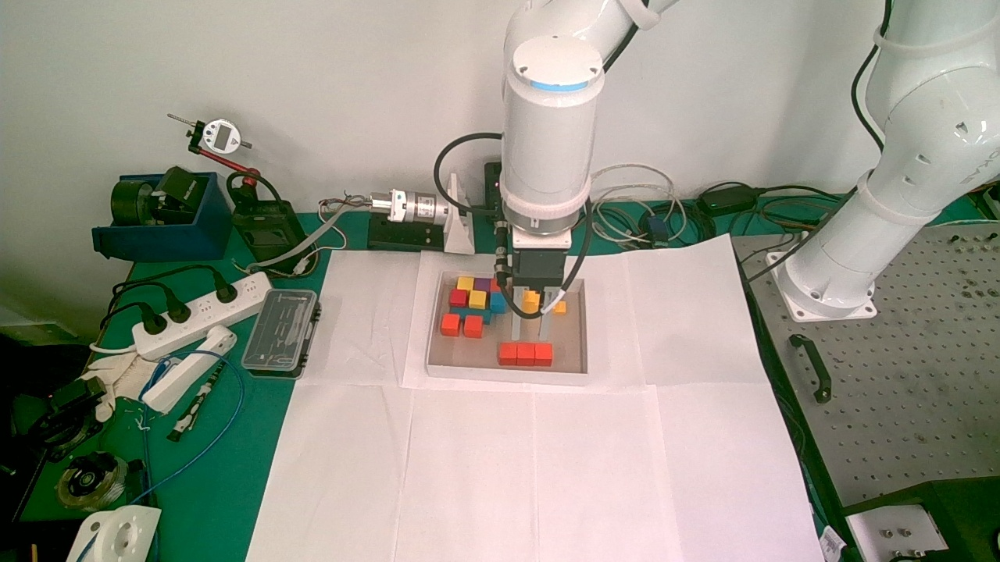

# 首次完整 RGB 抓取与入盒放置

2026-10-06 14:17（Asia/Hong_Kong）完成。机器人 xMate SR4-C，固定 D455 RGB 1280×720 / 10 Hz。没有使用深度。用户授权机器人速率 10%、夹爪力 20%，确认积木在验证抬升时随动，最终确认线材无问题并要求连续执行。

## 结果与证据

| 文件 | 内容 |
| --- | --- |
| [placement-20261006T061645887740Z.jsonl](placement-20261006T061645887740Z.jsonl) | 完整搬运、转向、下降、释放、退出的命令/反馈/停止证据 |
| [grasp-close-20261006T050313561345Z.jsonl](grasp-close-20261006T050313561345Z.jsonl) | 低力闭合直至稳定接触 412 的记录 |
| [gripper-check-20261006T061824906227Z.jsonl](gripper-check-20261006T061824906227Z.jsonl) | 最终初始化 1、状态 1、位置 462 |
| [placed.jpg](placed.jpg) | 退出末端 RGB，目视确认红色三联积木在盒内前侧、夹爪为空 |
| [calibration/](calibration/) | 同一安装的标定快照，非自动启用配置 |

原始 `captures/` 与 `logs/runs/` 仍保存在实验主机。版本化证据保留原始时区和字段，不因整理而重写运行记录。更多过程见 [会话历史](../../archive/2026-10-06-session-notes.md)。

## 本次几何与流程

- 物块 90.23 × 29.86 × 29.61 mm，用户测量；盒沿离桌 50 mm、底厚忽略，由用户提供。
- 工具为法兰至合理接触点 248 mm，开合轴为工具 X。没有根据图像投影外观修改用户已测定的工具参数。
- 抓取以顶面四条边求中心，排除可见侧面；高位对齐后下降到离桌 20 mm 的接触高度。夹爪以 20% 力逐步闭合至 412，验证抬升与随动后抬高搬运。
- 用户手动移开机器人后，两张无遮挡 RGB 确认纸盒候选，估算盒口 267.99 × 192.51 mm。前侧偏右有空位，已有积木主要在后侧和左侧。
- 既有彩色积木可见轮廓按 0..50 mm 高度扫描为保守占用区。假设 110 × 60 mm 携物外廓时，候选中心基座 XY 为 `[94.689,-560.395]` mm，距检测盒沿约 17.0 mm、距保守占用区约 10.6 mm。110 × 70 mm 未找到同等留量的落点。**外廓是规划假设，非实测夹爪/线缆尺寸。**
- 实机手动移位后重新从实时关节起点规划，未执行旧 J1 返回路线。最终连续路线检查 471 个 IK/FK 点，最小关节限位余量约 11.897°。
- 连续执行：高位 X 至 180 mm → Rz 至 -0.098124 rad → Y/X 到落点 → 竖直下降至接触点离桌 25 mm → 夹爪 412→462 小量张开 → 竖直抬升约 95.3 mm。全程速率参数 10%，未自动全开夹爪。
- 按抓持几何估计，释放时物块底面离盒底约 5 mm；这是几何估计，不是深度测量。完成后通过 RGB 看见物块留在盒内，机器人停止、idle、下电、断开 SDK。

## 可迁移经验与局限

侧面不能当顶面，像素中心不能直接当 TCP，用户工作区方向不能直接当机器人轴。RGB 加已知高度平面可完成定位，但不能假称获得了未知高度。遮挡时观察避让比强行接受模糊轮廓有效；检测候选必须与用户所指区域核对。

把所有合理的中间检查放进一次执行：实时起点核对、连续 IK/FK、关节/走廊监测、阶段夹持检查、单次尝试记录、异常停止、释放后退出及图像验收。不要反复询问已经授权的动作，也不要用细碎命令代替完整规划。

本次成功仅覆盖这个物体、姿态、工具、盒内布局和用户现场确认的线材情况。没有完整碰撞模型，夹爪位置寄存器未标定为毫米，桌面平面仍暂定；新任务应重新测量/估计对应量。历史动作源代码在 `scripts/archive/`，命令行已禁用，不能作为可重放配方。
