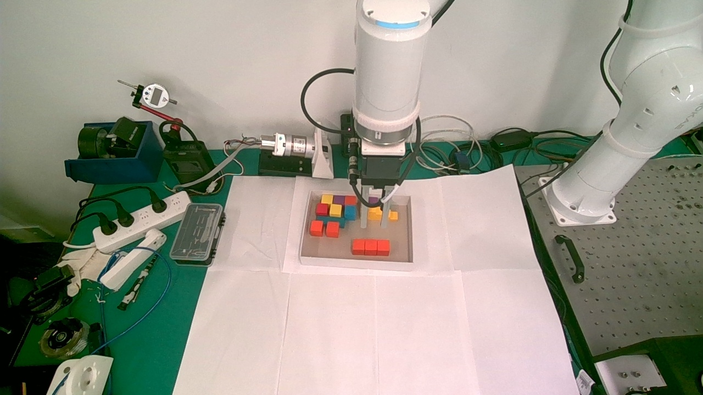

# 再次从白纸夹取红色长方体入盒

2026-10-06 15:07（Asia/Hong_Kong）完成。用户要求查看当前相机并将红色长方体放入白色灰底纸盒；机器人速率 10%，夹爪力 20%。全程从新照片和实际机器人起点规划，未重放历史路线。

## 结果与证据

- [夹持照片](holding.jpg)：高位侧移后，物块明确悬空随动，原白纸位置为空。
- [最终照片](placed.jpg)：释放并竖直退出后，红色三联长方体留在盒内前侧偏右。
- [执行事件摘录](events.jsonl)：保留四阶段计划检查、命令起止、夹持与释放、最终状态，带原日志文件名和原 UTC 时间；逐帧反馈仍在本机 `logs/runs/task-*.jsonl`，不批量加入版本记录。
- 本轮照片、视觉结果、新计划及单次尝试标记在本机 `captures/task-20261006-1447/` 与 `captures/20261006-*.jpg`，已执行计划不能重放。

## 本轮定位与执行

当前画面确认是已知的 90.23 × 29.86 × 29.61 mm 红色三联物块、既有 50 mm 盒沿纸盒及同一安装。顶面四边估计为 92.43 × 29.20 mm，中心基座 XY `[267.7165,-611.9648]` mm。保留既有 248 mm 工具接触点与活动标定。

高位接近、垂直抓取、携物观察、最终放置分别检查 275、187、399、713 个连续 IK/FK 样本；各阶段最小关节余量约 5.91°、7.79°、7.83°、11.64°。每阶段开始核对实际起点，保留 SDK 独占锁、模式/电源/工具/负载检查、TCP 走廊、关节构型、超时停止与单次尝试记录。

接触点离桌 20 mm 时，以每段 50 原始单位逐步闭合；位置 410 稳定接触后抬升 45 mm并拍照，随后抬至约 159 mm 高位、转向并侧移，获取无遮挡盒口照片。

盒沿最高分候选误取了前侧外壁底边，已拒绝；使用实际检测到的前侧上沿与左右、后沿组合，双帧边缘支持至少 90%，估算盒口 268.29 × 192.30 mm。对现有彩色积木按 0..50 mm 高度扫掠，并保留非凸占用并集；当前灰底/反光像素饱和度约 75..111，红色实体面约 189..195，采用 S>=120 加一像素边界扩张区分实体与反光。该阈值仅为当前图像适配，不是通用配置。

按 110 × 70 mm 携物/小量释放外廓选择基座 XY `[90.1934,-557.7562]` mm、偏航 `-0.1126564` rad；模型中距盒沿约 16.0 mm、距占用区约 11.7 mm。外廓仍为本场景的保守规划假设，并非新测量的完整碰撞模型。

最终连续执行高位搬运、转向、下降到接触点离桌 25 mm、夹爪 410→460 小量张开，再竖直抬升约 135.2 mm。释放时物块底面离盒底约 5 mm是沿用同一抓持几何的估计，任务成功以最终照片为依据。

## 最终状态与待改进项

15:07:12 香港时间的反馈：manual、idle、PowerState.off，随后断开 SDK；TCP 基座 m/rad 为 `[0.090193405,-0.557758251,0.120003598,3.117061585,0.000198542,-0.112655853]`，接触点离桌约 160.16 mm。夹爪初始化 1、状态 1、位置 460，串口关闭但仍上电，图像确认空夹。

用户随后指出夹爪闭合走走停停：`grasp_close.py` 当前每次减少 50，每段调用 `Hardware.gripper_step`，后者以 150 ms 间隔轮询并要求至少 3 次稳定到位反馈；本次共 12 段。机械臂连续路线已经流畅，夹爪仍沿用早期小步试夹。用户本轮是在询问原因，尚未修改夹爪策略或为验证发送新的硬件命令。

### 后续代码修改

2026-10-06（Asia/Hong_Kong），用户随后明确要求完成连续闭合修改。`grasp_close.py` 改为一次写入闭合目标，默认 0，可显式指定 `--target-position 0..999`；力固定 20% 并读回确认，执行前两次确认全开、初始化完成且空夹，150 ms 轮询反馈，仅在接触后进行连续 5 次稳定确认。保留行程/反向位移、初始化、掉落/接触丢失、无物到终点和 15 秒超时检查，不自动重发。网页点动的 500 单位行程上限未修改。只进行了离线语法、引用与差异检查，没有连接或移动硬件；这次成功实验仍使用修改前的 12 段闭合，不能当作新连续闭合的实机验证。
